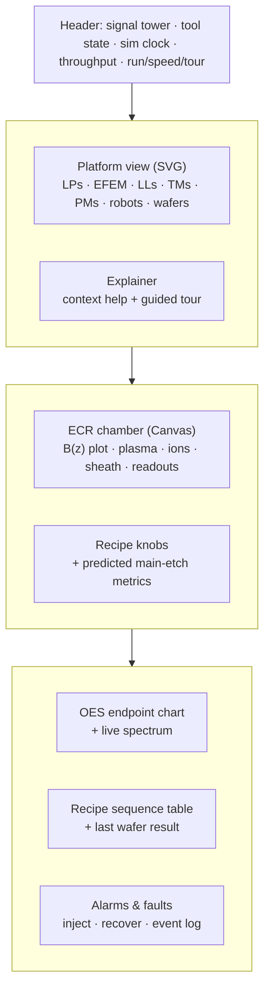
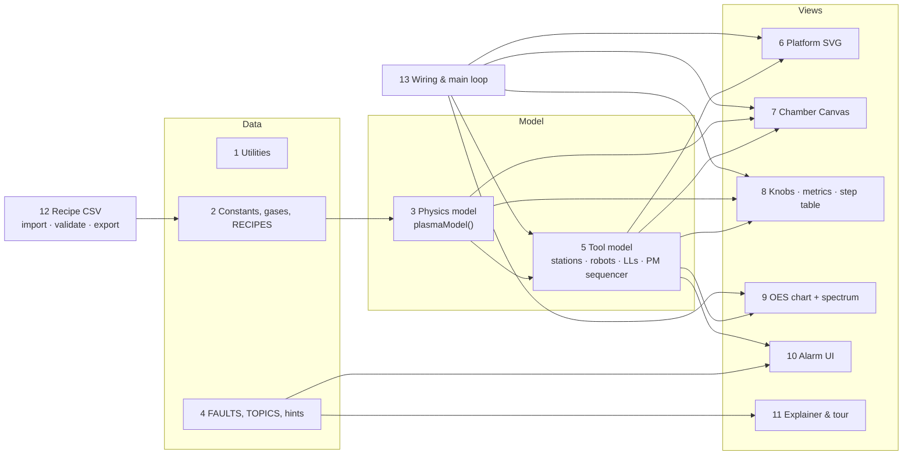
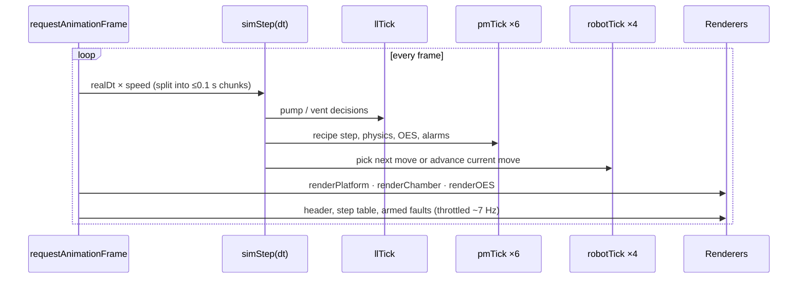
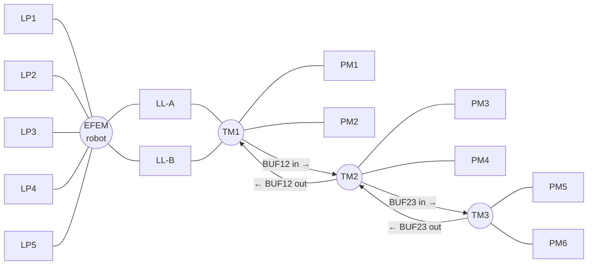
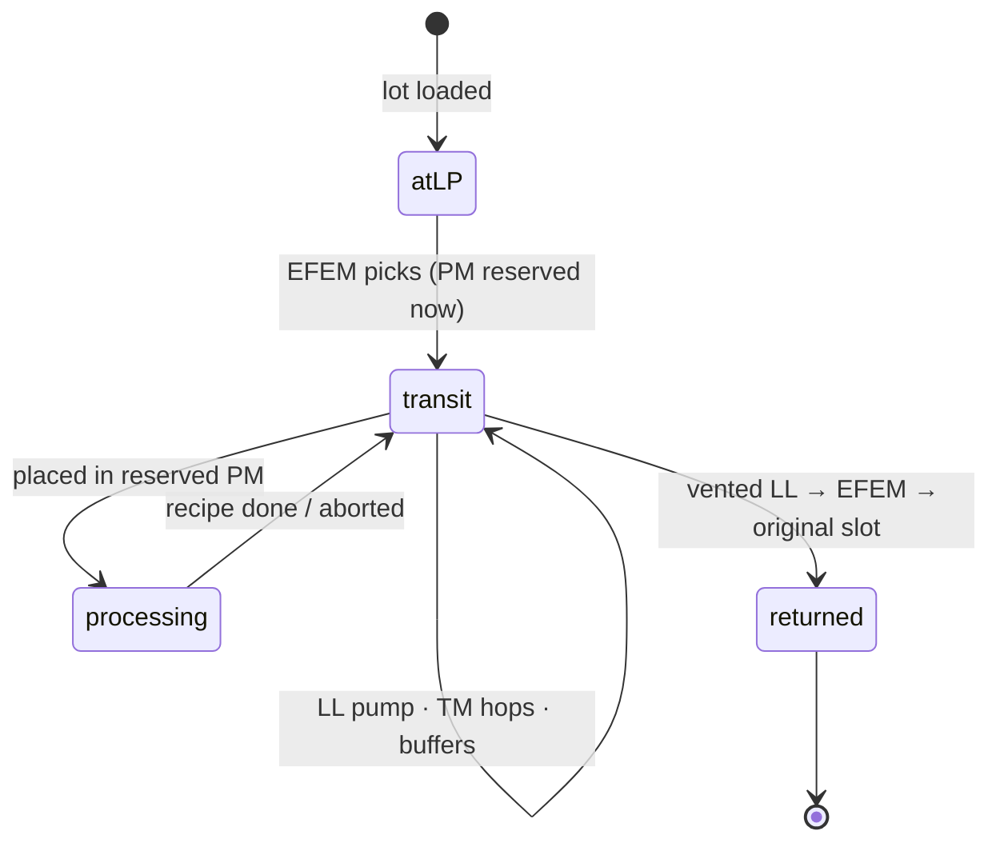
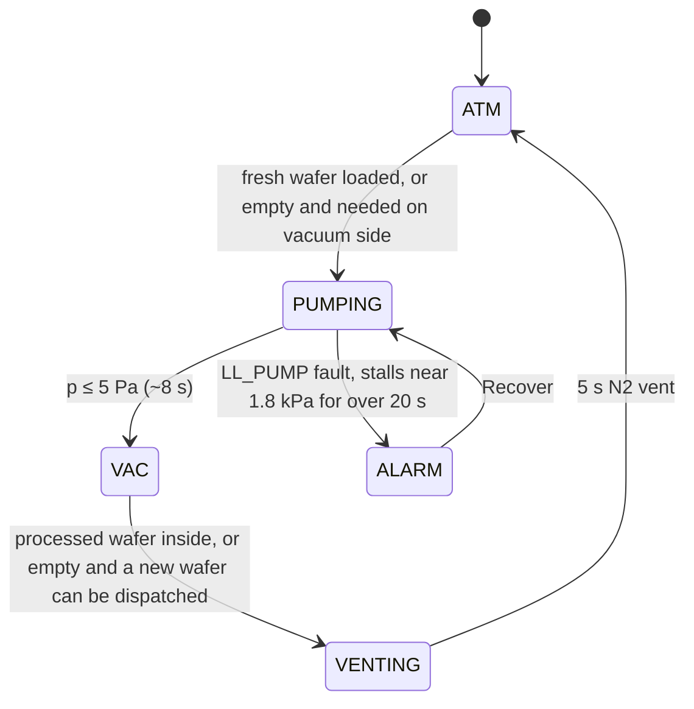
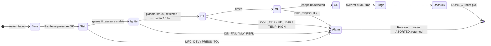
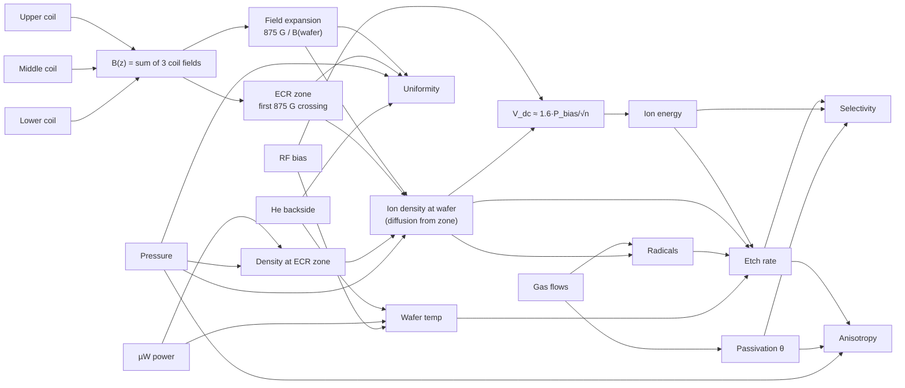
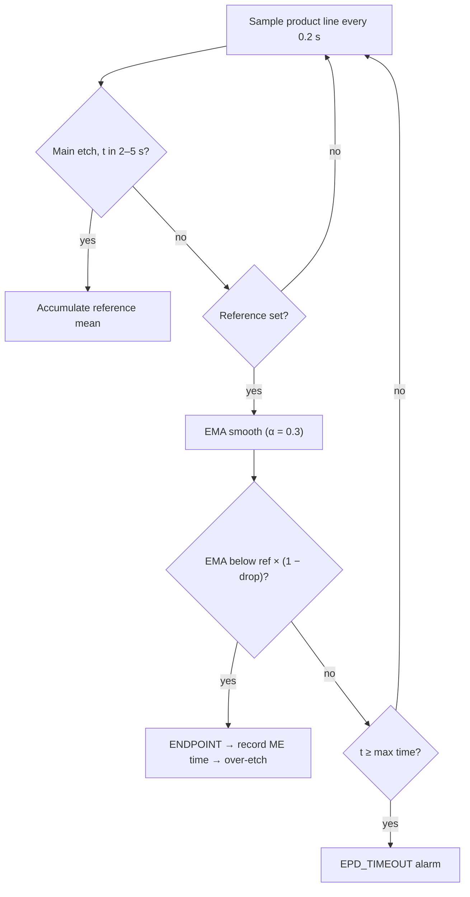

# Dry Etch ECR Plasma Simulator

An interactive, browser-based simulator and explainer for an **ECR (electron cyclotron resonance) plasma dry etcher**, written for process and equipment engineers. It runs entirely offline in plain HTML, CSS and JavaScript. There is no build step and no libraries.


> The physics is **illustrative, not quantitative**. Trends and trade-offs are realistic; absolute numbers are calibrated to plausible values, not to any specific tool.

---

## Quick start

1. Open `index.html` in Edge or Chrome. Double-clicking works; no web server is needed.
2. Click **★ Guided tour** for an 18-step walkthrough, or
3. Click **Load & run lot** to send 25 wafers through the tool, then click any PM to watch it.

A printable brochure is in [brochure.html](brochure.html), with a pre-rendered [brochure.pdf](brochure.pdf).

| Control | What it does |
|---|---|
| ❚❚ Pause / ▶ Run | Freezes or resumes simulation time |
| 1× 5× 20× 60× | Simulation speed multiplier |
| ⟲ Reset | Empties the tool and returns all modules to idle |
| Load port / Wafers / Chambers / Load & run lot | Places a FOUP with *n* wafers on a load port using the selected recipe, and runs it on a chamber pair (PM1&2, PM3&4, PM5&6 or Auto) |
| 1 wafer → PMx | Sends a single wafer to the currently selected chamber |
| Recipe knobs | Edit the main-etch step live. The three coils (upper / middle / lower) and He apply to every step |
| Load CSV… / Export CSV / ? | Load a recipe from a CSV file, save the selected recipe (with knob edits) as CSV, or show the format |
| Inject | Arms a fault on a chamber, robot or load lock |


## Screen layout



Hover any part of the chamber to get a tooltip; click it to show the full explanation. Metric cards, recipe rows and knob labels can also be clicked.

---

## Code architecture

| File | Purpose |
|---|---|
| `index.html` | Static page structure and panels |
| `styles.css` | Dark HMI theme, grid layout, signal tower, alarm cards |
| `app.js` | Everything else, split into numbered sections |



### Main loop

Process time and animation time are separate. The tool model advances in fixed **≤ 0.1 s sim-time sub-steps** (scaled by the speed multiplier). Particles animate in **real time**, so ions don't blur at 60×.



---

## Platform & wafer handling

Layout: **5 load ports → EFEM (atmospheric robot) → 2 load locks → TM1 ⇄ TM2 ⇄ TM3**. Each TM has a vacuum robot serving two ECR chambers. Adjacent TMs are linked by pass-through buffers with separate inbound and outbound slots.



### Wafer journey



### Scheduling rules (deadlock-free)

| Rule | Why |
|---|---|
| A lot runs on a **chamber pair** (PM1&2, PM3&4, PM5&6), alternating wafers between the two. *Auto* picks the least-loaded healthy pair | Matches how fabs run lots on matched chamber pairs; each pair sits on one TM |
| A PM is **reserved when the wafer leaves the FOUP** | Every wafer in vacuum has a guaranteed free destination, so the inbound chain always drains |
| The dispatcher skips wafers whose pair is busy | Lots on different pairs run in parallel without holding each other up |
| Robots try **outbound moves first** | Finished wafers leave quickly and chambers are freed |
| Buffers have **separate in/out slots** | Two-way traffic between TMs can't block itself |
| Robot moves are atomic, and **source and destination are reserved** for the whole move | No two robots compete for one station |
| EFEM **unloads before it loads** | The load locks never fill up with finished wafers |

Each robot move takes 3 s (TM) or 3.5 s (EFEM). The move has six phases: travel, extend, retract with wafer, travel, extend, retract. The wafer is picked at 35 % of the move and placed at 85 %.

### Load-lock state machine



---

## Process-module sequencer

Each PM runs the wafer's recipe as a list of typed steps. The main etch ends on **OES endpoint**. Over-etch is timed as a **percentage of the measured main-etch time**.



The oxide recipe has no breakthrough step, so Ignite goes straight to ME.

### Built-in recipes

| Recipe | Film / underlayer | Main-etch chemistry | Endpoint line | Nominal ER |
|---|---|---|---|---|
| Poly-Si gate etch | 150 nm poly-Si / 2 nm gate SiO₂ | Cl₂ / HBr / O₂ | SiCl 405 nm | 280 nm/min |
| Al-Cu metal etch | 500 nm Al-Cu / TiN | BCl₃ / Cl₂ | Al 396 nm | 650 nm/min |
| SiO₂ contact etch | 300 nm SiO₂ / Si | CF₄ / CHF₃ / Ar | CO 483 nm | 320 nm/min |

---

## Physics model

`plasmaRaw()` produces the raw model and `plasmaModel()` adds per-recipe calibration. The whole model is a short chain of simple, explainable relations:



Key relations:

* **ECR condition:** $f_{ce} = \dfrac{eB}{2\pi m_e} \approx 2.80\ \text{MHz/G} \times B \Rightarrow B_{ECR} = 875\ \text{G}$ at 2.45 GHz.
* **Three-coil field:** each solenoid is modelled as a loop, $B_i(z) = 40\,I_i \big/ \left(1 + ((z - z_i)/a_i)^2\right)^{3/2}$. The centres are 22, 63 and 132 mm below the window and the radii are 60, 60 and 80 mm. The ECR zone is the **first 875 G crossing** below the window.
  * **Upper** sets $B(0)$. With $B(0) \ge 875$ G the launch is *high-field* (magnetic beach, efficient); otherwise density drops by ~45 %.
  * **Middle** mainly positions the zone.
  * **Lower** sets $B_{wafer}$ and so the flux-expansion ratio $X = 875 / B_{wafer}$. Density at the wafer scales as $1/(1 + X/8)$, and uniformity is best near $X \approx 4$.
  * With the upper and middle coils off there is **no resonance and no plasma**.
* **Self-bias:** $P_{bias} \approx V_{dc} \cdot I_{ion}$, so at fixed bias power a denser plasma gives a lower $V_{dc}$.
* **Ion-enhanced etch (synergy):**
  $$ER \propto \Gamma_{ion}\,Y(E)\,\frac{\Gamma_{rad}}{\Gamma_{rad} + k\,\Gamma_{ion}Y(E)} + k_{chem}\,\Gamma_{rad}\,e^{(T-50)/60},\qquad Y(E) \propto \sqrt{E} - \sqrt{E_{th}}$$
* **Selectivity:** the underlayer has a higher energy threshold $E_{th}$, so selectivity rises steeply at low bias. Passivating gases (O₂, CHF₃, HBr) reduce underlayer loss.
* **Anisotropy:** $1 - \text{lateral}/\text{vertical}$. The lateral rate grows with wafer temperature and pressure (scattering) and falls with passivation.
* **Calibration:** at recipe defaults, ER and selectivity are scaled to the recipe's nominal values. Every deviation follows model trends.

---

## OES endpoint detection



The product-line intensity is proportional to etch rate × (1 − cleared fraction). The cleared fraction is a normal CDF whose width comes from the uniformity, so poorer uniformity gives a softer, later drop. A **clouded OES window** (EPD_TIMEOUT fault) adds stray background light, so the drop never crosses the threshold.

---

## Faults

Faults are **armed** first and then trigger at the realistic point in the sequence. Some alarms also occur naturally from bad knob settings.

| Code | Fault | Triggers | Natural cause you can create |
|---|---|---|---|
| PM-101 | µW reflected power high | Ignite / plasma steps | — |
| PM-102 | Plasma ignition failure | Ignite | Upper + middle coils ≈ 0 (no 875 G crossing) |
| PM-103 | Solenoid coil PSU trip | 1.5 s into a plasma step | — |
| PM-201 | Pressure out of tolerance | End of gas stabilize | — |
| PM-202 | MFC flow deviation | 2 s into gas stabilize | — |
| PM-301 | He backside leak | 2.5 s into a plasma step | — |
| PM-302 | Wafer temperature high | Any plasma step | He backside ≈ 0 |
| PM-401 | Endpoint timeout | Main etch max time | Very low etch rate |
| TR-501 | Robot wafer presence error | Next pick of that robot | — |
| LL-601 | Load-lock pump-down timeout | Next pump-down > 20 s | — |

**Recover** clears the alarm. A wafer in an alarmed PM is flagged **ABORTED** (red) and returned to its FOUP slot.

---

## Recipe CSV files

Click **Load CSV…** in the recipe-knobs panel to add a recipe. The file is parsed in the browser and never leaves the PC. **Export CSV** writes the selected recipe, including any knob edits, in the same format, so the easiest way to start is to export a built-in recipe and edit it in Excel. An example is in [recipes/example-poly-gate-low-damage.csv](recipes/example-poly-gate-low-damage.csv).

The file has two parts. First, optional **settings rows**, with the name in column A and values after it:

| Setting | Values | Default if missing |
|---|---|---|
| `Recipe` | display name | file name |
| `Template` | `poly`, `al`, `ox` or `sin`: supplies material constants (etch thresholds, plasma colour) | guessed from main-etch gases |
| `Film` | name, thickness (nm) | template |
| `Underlayer` | name, thickness (nm) | template |
| `Nominal ER (nm/min)` | expected main-etch rate at the file's settings | template |
| `Nominal selectivity` | expected selectivity at the file's settings | template |
| `Coil upper (A)` / `Coil middle (A)` / `Coil lower (A)` | 0–27 | template |
| `He backside (Pa)` | 0–2000 | template |
| `EPD species` / `EPD wavelength (nm)` / `EPD drop (%)` / `EPD max time (s)` | endpoint settings | template |

Second, a **step table**, starting at a header row whose first cell is `Step`:

```csv
Step,Name,Type,Time (s),Over-etch (%),uW (W),Bias (W),Pressure (Pa),Cl2,HBr,O2,CF4
1,Base pressure check,BASE,3,,,,,,,,
2,Gas stabilize,STAB,5,,,,,,,,
3,Plasma ignite / tune,IGNITE,2,,,,,,,,
4,Breakthrough,BT,5,,800,60,0.4,,,,50
5,Main etch (EPD),ME,,,850,35,0.5,40,110,4,
6,Soft landing over-etch,OE,,50,650,10,1.2,,130,5,
7,Plasma off / purge,PURGE,4,,,,,,,,
8,ESC dechuck / lift,DECHUCK,3,,,,,,,,
```

* **Type** is one of `BASE`, `STAB`, `IGNITE`, `BT`, `ME`, `OE`, `PLASMA`, `PURGE`, `DECHUCK`. Common synonyms such as `Main etch`, `Overetch` and `Ash` are also accepted. Exactly one `ME` is required.
* `ME` with an empty Time ends on endpoint. If it has a Time, it **always runs that long and EPD only monitors**, which suits partial (timed) etches. `OE` runs for *Over-etch (%)* of the measured ME time. `PLASMA` is a timed plasma step that doesn't etch the film (ash, plasma dechuck). All other steps use *Time*.
* `BT`, `ME`, `OE` and `PLASMA` need µW, bias, pressure and at least one gas. Gas columns can be any of Cl2, HBr, O2, CF4, CHF3, Ar, BCl3, CH3F, NF3, SF6, He, N2, H2, CH4, CO2, SO2, SiCl4, SiF4.
* Optional `Coil U (A)`, `Coil M (A)`, `Coil L (A)` columns set coils per step. The ME step's coils become the recipe coils (the knobs). An `EPD dead time (s)` setting delays the EPD reference window.
* Validation:
  * **Errors** stop the load: bad step type, missing or non-numeric values, no ME step, or main-etch settings that give no plasma.
  * **Warnings** load the recipe anyway: unknown columns, values clamped to range, missing settings.
  * Both are listed in the Explainer panel.
* Semicolon-separated files from comma-decimal Excel locales are detected automatically.

### Tool recipe exports

The equipment's own recipe export can be loaded directly. It is detected by its first row `No, Item, Unit, <step 1>, <step 2>, …`, with one parameter per row and one step per column. Mapping:

| Tool item | Simulator |
|---|---|
| Step Time | step time |
| Source Power | µW power; a step with power and gas is a plasma step |
| Gas *n* Flow Rate(*gas*) (mL/min) | gas flow in sccm; duplicate lines for the same gas are summed |
| Process Pressure | pressure. With Pressure Control Mode 0 (fixed valve) it is assumed to be 1.0 Pa |
| W-Bias (Inner/Outer) Power + TM Frequency/Duty | bias = inner power (mean if they differ) × TM duty, i.e. time-averaged |
| COIL U/M/L Current | per-step coils (capped at 27 A) |
| Backside Pressure (kPa) | He backside (Pa) |
| EPD Recipe ≠ 0 | that step is the main etch. It runs its full Step Time and EPD only monitors, after EPD Dead Time |
| other plasma steps | timed `PLASMA` steps (e.g. ASH, DC) |

Implicit base-pressure, gas-stabilize, ignite and purge steps are added around the file's steps. Film thickness, etch rate and EPD line are not in tool exports, so they come from the material template, e.g. SiN: 57 nm pre, 32.6 nm/min, CN 387 nm. Use **Export CSV** to convert a tool recipe to the editable format and adjust those values.

---

## Extending

* **New recipe:** the quickest way is a [recipe CSV](#recipe-csv-files). To build one in, add an entry to `RECIPES` in `app.js` with `film`, `under`, `nominal`, `kChem`, `hw`, `epd`, `glow`, `lines` and `steps`. It is calibrated automatically at start-up and appears in the recipe dropdown.
* **New gas:** add reactivity and passivation weights to `GASES`.
* **New fault:** add it to `FAULTS` (and `FAULT_TOPIC`), then trigger it in `pmTick`, `robotTick` or `llTick`.
* **New explainer topic:** add it to `TOPICS`. Any element with `data-topic="id"` becomes a clickable link.
